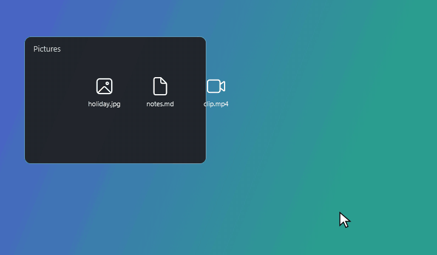
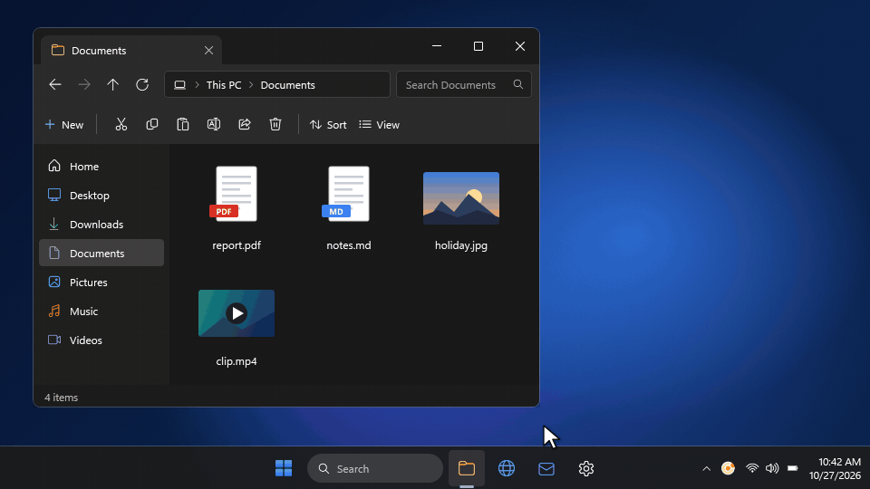
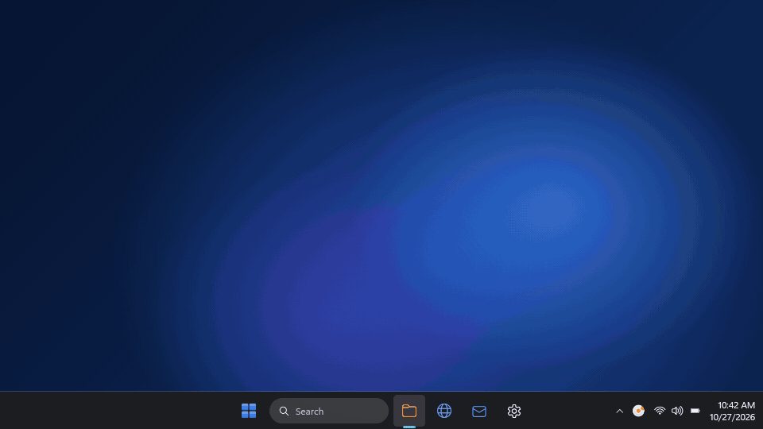

<p align="center"></p>

# Circularity

A file converter for Windows that lives at your cursor: drag a file, tap right-click (or Shift)
mid-drag, and drop it on a button in the wheel that pops up around it.



Everything happens on your PC: nothing is uploaded, and the original file is never changed.

[](LICENSE)
[](https://github.com/AtharvGogia/Circularity-for-Windows/releases)
[](https://github.com/AtharvGogia/Circularity-for-Windows/releases)

Made by **Atharv Gogia**. Open source under the [MIT licence](LICENSE).

## Download

Get `CircularitySetup-x.y.z.exe` from the
[Releases page](https://github.com/AtharvGogia/Circularity-for-Windows/releases) and run it. It
installs for your user only (no admin prompt) and includes everything it needs. Windows 10 (1809 or
later) or Windows 11, 64-bit.

The installer isn't code-signed, so Windows SmartScreen may say "Windows protected your PC" the
first time: choose **More info → Run anyway**.

To update later, right-click the tray icon → **Check for updates…** (or use the button in Settings),
or turn on automatic checks in Settings → Features.

## What it does

A tray app that:

1. Watches for a file drag (left button held and moved), using system-wide low-level hooks.
2. Opens the wheel when, mid-drag, you either:
   - **press the right mouse button**, or
   - **press Shift**. This is the fallback for touchpads, where pressing two buttons while
     dragging is awkward. If Shift was already held when the drag started, the wheel stays out
     of the way, so Explorer's own Shift-to-move still works.

   The right-click or Shift press is swallowed, so the app you're dragging from never sees it.
3. Shows a translucent wheel around the cursor, its ring split into curved, icon-labelled segments. The wheel is a
   real drop target: keep dragging onto a button and release. Dropping in the middle cancels;
   dragging off the wheel dismisses it, and the drag carries on as normal.

   The ring holds **at most six buttons**, so each stays big enough to aim at without looking. When a
   file has more to offer, the bottom one becomes **More**: resting on it fans the rest out into an
   arc just outside the wheel, which you drop onto the same way. Everyday formats sit at the top and
   on the right; buttons that open a dialog first (Resize, Compress, Crop) always sit to the left of
   More, on the ring or at the left end of the arc. Near the bottom of the screen, where the arc
   wouldn't fit, More moves to the top and the arc opens upwards instead.

   While you drag, the label under the file says what letting go will do ("Convert to PNG", or
   "Cancel" over the middle), for drags that Windows draws, such as those from File Explorer.

   **Without dragging**, the same wheel opens at the cursor in click mode: hover and click a button,
   or use the arrow keys and Enter; Esc, the centre or clicking elsewhere cancels. Three ways in:

   

   - **Ctrl+Alt+C** with files selected in File Explorer (any tab) or on the desktop
   - **Right-click → Convert with Circularity** (added by the installer; on Windows 11 it's under
     "Show more options")
   - **Right-click → Send to → Circularity**, which hands over every selected file at once

   Launching Circularity while it's already running hands the files to the running copy (or, with no
   files, opens Settings), so these never start a second copy.
4. Runs the job in the background:
   - **Images** → PNG, JPG, BMP, GIF, TIFF (Windows Imaging Component), WebP (decoded by Windows,
     encoded by FFmpeg's libwebp), PDF. **iPhone HEIC/HEIF photos and AVIF** are read too: by
     Windows when it has the codec, otherwise by the bundled FFmpeg, so they work without buying
     Microsoft's HEVC extension. Photos taken sideways come out the right way up.
     **SVG** files are read and drawn with Svg.Skia, keeping transparency. Being vector, small ones
     (icons) come out at 1024 px rather than at their tiny nominal size, and huge ones at most
     4096 px. Anything an SVG links to outside itself (web pictures, fonts, styles, other files) is
     ignored, so converting one never contacts a server.
   - **Video** → MP4, WebM, MOV, GIF, MP3 (FFmpeg); reads iPhone HEVC and ProRes videos too
   - **Audio** → MP3, WAV, FLAC, OGG, M4A (FFmpeg); reads Apple's CAF, AIFF and Apple Lossless too
   - **Resize** (images and video): to a width × height, keeping the aspect ratio (fit inside) or
     not (stretch). Opens a small dialog that shows the resulting size.
   - **Compress**:
     - **Images**: by **quality** percentage, or to a **target file size** (e.g. 500 KB), where it
       keeps the highest quality that fits and scales the picture down only if even low quality is
       too big. Saved as JPG (transparent areas become white); the notification shows the size before
       and after.
     - **Videos**: higher quality / balanced / smaller file, or to a **target size** (e.g. 25 MB, with
       buttons for common limits), optionally at a lower resolution (1080p, 720p, 480p). The window
       estimates the result's size. Saved as H.264 MP4, which plays everywhere; a target size that
       would make the picture too blocky lowers the resolution automatically.
     - **PDFs**: light (200 dpi), balanced (150 dpi) or strong (100 dpi). Only the pictures inside are
       re-saved smaller (with PDFium); text and drawings stay exactly as they were. Every page is
       compared with the original afterwards, and if any would look different, the PDF is left alone.
   - **Trim** (videos and audio): pick the start and end with sliders or by typing a time, with the
     frame at each cut point shown. **Exact cut** re-encodes so it starts and ends exactly there;
     **quick cut** copies the streams (instant, no quality loss, but a video may start a little early,
     at the previous keyframe).
   - **Crop** (images and video): opens an editor with a crop box you can move, resize from any
     corner or edge, or redraw, optionally locked to 1:1, 4:3, 3:2, 16:9 or 9:16. Videos are
     shown as a frame from about one second in. Several files are cropped one after another.
   - **Documents**, with nothing extra to install:
     - **PDF** → PNG / JPG (one image per page; several pages go into a `name (pages)` folder) using
       PDFium (the PDF engine in Chrome), and → TXT using PdfPig
     - **Markdown** → PDF or HTML, **HTML** → PDF, **TXT** → PDF, laid out by Edge (WebView2), on
       A4 or US Letter depending on your region
   - **Documents through Microsoft Office**, when it's installed (otherwise these buttons don't appear):
     - **Word**: DOCX / DOC / RTF / ODT → PDF, DOCX, TXT
     - **Excel**: XLSX / XLS / ODS / CSV → PDF
     - **PowerPoint**: PPTX / PPT / ODP → PDF

     Office runs invisibly. If you already had that Office app open, your copy is used and left
     open. A password-protected file fails straight away instead of asking for a password, and an
     Office job that hangs is stopped after 3 minutes.
   - **Combine** (two or more images and/or PDFs): one PDF with every page, in the order dropped.
   - **Your own buttons**: tick "Also add this as a button on the wheel" in a Resize or Compress
     window, and that exact resize or compression becomes a one-click button (named, say,
     "1920×1080" or "Under 25 MB"). These run straight away, without the window. A compression
     button only appears for the kind of file it was made for (a video one for videos, and so on).

Results are saved as new copies next to the original: `photo.png`, `photo (resized).jpg`,
`photo (cropped).jpg`, `photo (compressed).jpg`, `scan (combined).pdf`, with ` (1)`, ` (2)`... if the name is taken. The original is never touched:
the wheel always answers the drag with "Copy", never "Move".

While something is running, hover the tray icon to see progress
(`clip.mov → MP4 43% (+2 more)`). **Cancel conversions** in its menu stops everything. A cancelled or
failed job leaves no half-written file behind. You get one notification per drop; clicking it shows
the result in File Explorer.

The first time Circularity starts, a short welcome explains the gestures. For everything else there's
a **tutorial** built in: thirteen chapters, from opening the wheel to every format and tool, your own
buttons, settings and troubleshooting, with a wheel to try and a practice picture to drag. Both are in
the tray icon's menu under **Help** and in Settings → **Help**.

### Settings



Double-click the tray icon (or right-click → **Settings…**) for the following. The wheel preview in
Settings is live: hover and click it, and switch it between image, video, audio and document files.

- **Wheel**: **theme** (same as Windows, following it live, or light or dark, for the wheel and
  every window), **size** (200–360 px), **background opacity**, and **accent colour** (presets or
  any custom colour; the tray icon follows it)
- **Buttons**: for each kind of file, move buttons up and down (higher ones get a place on the ring
  first, the rest go behind More), hide the ones you never use, and delete your own buttons. Each
  one says where it ends up. Dialog buttons stay left of More whatever the order.
- **General**: which **gestures** are on (right-click, Shift, the Ctrl+Alt+C shortcut),
  **notifications** when conversions finish and when Circularity starts (problems always show), and
  **start at sign-in**: the same Windows sign-in entry the installer's checkbox creates, so the two
  always agree; it also notices (and, when ticked, undoes) "Disabled" in Task Manager's Startup apps
- **Features**: **copy converted files to the clipboard** when conversions finish (the files
  themselves, like Ctrl+C in File Explorer, so you can paste them into another folder or app), and
  **check for updates automatically**, off by default: when Circularity starts, or every day, 3
  days, week or 30 days. A new version is mentioned once, in a notification that opens the
  update window
- **Help**: the tutorial, the welcome guide, and **Report a bug**, which opens a new GitHub issue
  and copies the diagnostics (below) to the clipboard to paste into it. They stay on the clipboard,
  never in the web address, since they include folder paths
- **About**: what Circularity found on this PC (FFmpeg, Office, WebView2, PDFium, Windows) and
  **Copy diagnostics**, which puts that list and the end of the log on the clipboard for a bug report

Changes apply live, with a preview, and are saved to `%APPDATA%\Circularity\settings.json`.

## Build the installer

One command builds everything users need, with .NET and FFmpeg included:

```bash
powershell -ExecutionPolicy Bypass -File build\build.ps1
```

It produces, in `artifacts\`:

| Output | What it is | Size |
| --- | --- | --- |
| `artifacts\CircularitySetup-x.y.z.exe` | The installer to hand out | ~72 MB |
| `artifacts\Circularity\Circularity.exe` | The app itself, in a self-contained folder that also runs without installing (e.g. from a USB stick) | ~240 MB folder |

The installer:

- installs for the current user, so there's no admin prompt, into
  `%LOCALAPPDATA%\Programs\Circularity\Circularity.exe`
- adds a Start menu shortcut and a **Send to** entry, and optionally **Convert with Circularity**
  on files' right-click menu (on by default), starting at sign-in, and a desktop shortcut
- installs Microsoft's WebView2 only on the rare PC that doesn't have it (Windows 11 always does)
- appears in **Settings → Apps** with a normal uninstaller, which also removes the sign-in entry

It isn't code-signed, so Windows SmartScreen shows "Windows protected your PC" the first time;
users click **More info → Run anyway**.

One-time setup for building it:

```bash
winget install Microsoft.DotNet.SDK.10
```

```bash
winget install JRSoftware.InnoSetup
```

```bash
winget install MSYS2.MSYS2
```

MSYS2 is only needed to compile FFmpeg, which happens once (a few minutes) and is reused after
that; `build\build.ps1 -RebuildFfmpeg` forces a fresh one. That FFmpeg (`build\ffmpeg\build-ffmpeg.sh`)
is a slim LGPL build, 29 MB instead of the usual 230 MB: only the encoders, containers and filters
Circularity uses, every decoder so it still reads almost anything, and H.264 encoding through
Windows' built-in encoder instead of the GPL x264. It needs only DLLs that come with Windows.
Licences for everything bundled are in `build\installer` and ship in the app's `licenses` folder,
listed in `THIRD-PARTY-NOTICES.txt`.

## Run it for development

Needs the .NET 10 SDK, and FFmpeg for video/audio:

```bash
winget install Gyan.FFmpeg
```

The app looks for `ffmpeg.exe` in `FFMPEG_PATH`, next to the app, in a `tools\` folder beside it,
then on `PATH`.

```bash
dotnet run --project src/Circularity
```

That development build lands in `src\Circularity\bin\Debug\net10.0-windows10.0.19041.0\Circularity.exe`
and needs .NET 10 installed; the installer above is what to give other people.

A tray icon appears with a "Circularity is running" notification. Right-click it for
**Settings…**, **Check for updates…**, **Help**, **Pause gestures**, **Cancel conversions**,
**Open log** and **Exit**.

## Test it

A console harness generates sample video, audio and image files with FFmpeg, runs every supported
conversion, resize, crop and compression through the real queue, and checks the outputs decode
cleanly, have the right pixel sizes, and fit under the requested file size. It also checks naming,
unsupported formats, batches, progress and cancellation.

```bash
dotnet run --project src/EngineSmokeTest
```

To test against the slim FFmpeg that ships in the installer, point `FFMPEG_PATH` at it first
(`$env:FFMPEG_PATH = "build\ffmpeg\out\bin\ffmpeg.exe"` in PowerShell).

It can also render the wheel, the settings window and the resize / compress / crop dialogs to
PNGs, to check the look:

```bash
dotnet run --project src/EngineSmokeTest -- --render-previews previews
```

And it can do a real drag-and-drop onto the wheel with synthetic mouse input, checking that
dropping on a button picks it and that dragging off dismisses the wheel. **It moves your mouse for
a few seconds**, so keep your hands off it while it runs:

```bash
dotnet run --project src/EngineSmokeTest -- --drag-test
```

`--interaction-test` checks the no-drag ways in: the hand-off between launches, the Ctrl+Alt+C
registration, click mode by keyboard, and reading the selection from a real File Explorer window
(an Explorer window and the wheel flash up briefly; run it with Circularity closed).

`--update-test <installer.exe>` checks the updater against fake GitHub responses (newer / same /
no releases), refuses downloads from anywhere but github.com, rejects a fake installer and accepts
the real one, then asks the real GitHub API once.

`--render-readme-media docs\media` re-renders the GIFs in this README from the real wheel and its
animations (nothing on screen is recorded). `--write-icon src\Circularity\Assets\Circularity.ico`
regenerates the app icon.

`--startup-test` checks the start-at-sign-in toggle against the real registry, then restores
whatever was there before.

Everything the hooks decide is written to `%LOCALAPPDATA%\Circularity\log.txt`.

## Known limits

- The gestures only arm when the app you drag from is on an allowlist (Explorer and the main
  browsers and mail apps, see `App.xaml.cs`) and nothing full-screen is running.
- Dragging from an app running as administrator won't drop onto the wheel; Windows blocks
  drops from elevated apps into normal ones.
- HEIC, HEIF and AVIF can be read but not written, so resizing or cropping them produces a JPG.
  Without Microsoft's image extensions they're decoded by FFmpeg, which takes a moment longer.
- iPhone videos filmed in HDR can come out with paler colours when converted, since the bundled
  FFmpeg has no HDR-to-SDR tone mapping.
- Animated GIFs are edited as their first frame only.
- PDF → DOCX isn't offered. Word can do it, but first shows a "Word will now convert your PDF"
  prompt that an invisible Word can't answer. Silencing it means changing a Word option.
- Markdown/HTML/TXT → PDF needs the WebView2 runtime. It's part of Windows 11 and most up-to-date
  Windows 10 PCs; without it those buttons don't appear.

## How it's put together

| File | What it does |
| --- | --- |
| `GestureHook.cs` | Mouse + keyboard hooks on their own thread; detects right-click or Shift mid-drag and swallows it. |
| `WheelWindow.xaml(.cs)` | Transparent, never-focused, topmost window; the drop target; dismisses when dragged off. |
| `WheelView.cs` | Draws the wheel (also used for the live preview in Settings). |
| `Formats.cs` | Which buttons (formats, tools, your own) to offer for the dropped files, in your order, and their icons. |
| `SettingsWindow.xaml(.cs)` / `Settings.cs` | Settings UI with live preview / the saved settings, presets and button order. |
| `PresetNamer.cs` | The "also add this as a button on the wheel" option in the Resize and Compress windows. |
| `DropFeedback.cs` | The label under a dragged file ("Convert to PNG", "Cancel") while it's over the wheel. |
| `Diagnostics.cs` | What was found on this PC, for the About tab and "Copy diagnostics". |
| `ResizeDialog.xaml(.cs)` | Resize options. |
| `CompressDialog.xaml(.cs)` | Image compression options (quality or target size). |
| `VideoCompressDialog.xaml(.cs)` / `PdfCompressDialog.xaml(.cs)` | Video and PDF compression options. |
| `TrimDialog.xaml(.cs)` / `Times.cs` | Trim window for videos and audio / reading and writing times like "1:23.4". |
| `CropWindow.xaml(.cs)` | Crop editor. |
| `AppIcon.cs` | Draws the app icon in the accent colour: white or charcoal to stand out on the taskbar, and a simpler design at 32 px and below. |
| `Engine/ConversionQueue.cs` | Background job queue (two at a time): progress, cancellation, per-drop batches, cleanup of failed output. |
| `Engine/Operations.cs` | Convert / resize / crop / compress, and how a resize maps a source size to a new one. |
| `Engine/IConverter.cs` | The interface each backend implements. |
| `Engine/ImageConverter.cs` | Images via Windows Imaging Component, including EXIF rotation. |
| `Engine/FfmpegConverter.cs` | Runs `ffmpeg.exe` for video/audio; reads video sizes, grabs preview frames, parses progress. |
| `Engine/PdfConverter.cs` | PDF → images (PDFium, `Engine/Pdfium.cs`) and text (PdfPig); images/PDFs → one PDF (PdfPig). |
| `Engine/WebPdfConverter.cs` | Markdown / HTML / TXT → PDF in a hidden WebView2; Markdown → HTML (Markdig). |
| `Engine/OfficeConverter.cs` | Word / Excel / PowerPoint automation, with the hang and password safeguards. |
| `Engine/Sta.cs` | Runs work on the single-threaded apartment thread WPF imaging and Office need. |
| `Engine/OutputPaths.cs` | Picks a free output name (or folder) next to the original and reserves it. |
| `Theme.cs` | Light / dark / same-as-Windows, for the wheel and the windows. |
| `InstanceChannel.cs` | One running copy; later launches hand their files over a private named pipe. |
| `GlobalHotkey.cs` / `ExplorerSelection.cs` | Ctrl+Alt+C, and reading the selected files from Explorer or the desktop. |
| `WelcomeWindow.xaml(.cs)` | The first-run welcome. |
| `TutorialWindow.xaml(.cs)` | The full tutorial: chapters, a wheel to try, and a practice picture. |
| `StartAtSignIn.cs` | The start-at-sign-in toggle (shared with the installer). |
| `App.xaml.cs` | Tray icon and menu, gesture checks, routing wheel buttons to dialogs and the queue, notifications. |
| `UpdateChecker.cs` / `UpdateWindow.xaml(.cs)` | "Check for updates": GitHub Releases, download, verify, upgrade. |

## Publishing a release

The in-app updater looks at this repository's latest GitHub release, so a release must:

1. be tagged `vx.y.z`, where `x.y.z` is `<Version>` in `src/Circularity/Circularity.csproj`, and
2. have the installer from `build\build.ps1`, `CircularitySetup-x.y.z.exe`, attached as an asset.

Whatever is written in the release's description is shown in the update window as "what's new".
The repository has to be public for the updater to see releases.

## Licence

Circularity is open source under the [MIT licence](LICENSE): © 2026 Atharv Gogia. The installer
bundles third-party components under their own licences (FFmpeg under the LGPL, and others);
they're listed in `build/installer/THIRD-PARTY-NOTICES.txt` and ship in the app's `licenses` folder.

Everything bundled was chosen so that Circularity itself can stay under the MIT licence:

- **FFmpeg** is a custom LGPL build (see [Build the installer](#build-the-installer)). It's a
  separate program Circularity runs, which anyone can swap for their own build. It leaves out x264
  and every other GPL part, since shipping those would bring the GPL's terms into the installer.
  The Gyan "full" FFmpeg suggested for development *is* GPL, so it's fine on your own PC but must
  not be shipped.
- **PdfPig** (Apache-2.0), **Markdig** (BSD-2-Clause), **PDFium** (BSD-3-Clause / Apache-2.0, plus
  permissive licences for what it bundles), **Svg.Skia** and **SkiaSharp** (MIT, with Skia under
  BSD-3-Clause), the SVG library behind them (Ms-PL) and the **WebView2** SDK (Microsoft's
  redistributable licence) all allow use in an MIT project. Where a bundled library offers a choice
  of licences (FreeType, for instance), it's used under the non-GPL one.
- **PDFsharp** was deliberately not used: from version 6.5 it's AGPL, which would require
  Circularity to be released under the AGPL instead of MIT.
